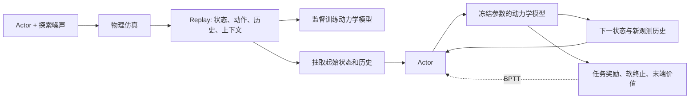

# SuperMimic 原理与训练流程：官方、Go2 和 HIMLoco

审计日期：2026-11-14。代码以 `manifests/upstreams.json` 的提交为准；论文参考 arXiv:2610.28480 v2。这里讲训练机制，WBLWBL 接入细节见 `02-himloco-audit.md` 和 `method-design.md`。方括号来源 ID 对应[可点击源码索引](source-index.md)及 `sources.json` 中的提交、文件和方法位置。

## 1. 它解决的是策略训练问题

普通 HIM-PPO 从物理仿真获取状态转移和奖励，用采样动作的概率比与优势更新策略。SuperMimic 另外学习动力学代理，在代理中展开短轨迹，将奖励对动作的导数传给策略。这条梯度不经过 PhysX 或 MuJoCo 的接触求解器，而经过神经网络。物理仿真仍负责提供可信的训练数据和评估。

用同一机器人完成不同动作时，目标不同但动力学有共享性。世界模型可以复用来自不同策略、指令的旧数据。这解释了大规模运动跟踪场景下的潜在收益；不能从人形运动库的 GPU-hours 比例推导 WBLWBL 的加速倍数。[P1 §3.1–3.3、§4]



## 2. 训练状态、策略观测和任务目标不能混用

记 `s` 为物理状态，`h` 为历史观测，`c` 为速度或参考运动目标，`xi` 为仿真上下文，`a` 为策略动作。对于 WBLWBL，Actor 仍应使用六帧本体观测；基座线速度和真实物理参数可以进入训练用世界模型或 Critic，但不直接进入部署 Actor。

模型的典型接口为 `next_state = dynamics(state, action, context)`。这不要求 state 等于 actor_obs。Go2 还显式输入上一动作和局部地形，并预测平面位姿增量；其 Actor 看历史传感信息而不是模型的全部输入。[G-WM `WorldModel.forward`; G-IM `_step`/`rollout`]

官方基础 Runner 默认 `actor_obs='rep_state'`、`history_length=1`，另支持 `proprio` 历史输入。论文的部署观测配置和当前基础类默认值不是同一件事。迁移时不能照抄默认值后宣称保持了 HIM 的信息约束。[O-RUN `BaseRunnerCfg`, `build_world_model`; P1 Appendix A]

## 3. 世界模型：从一步拟合到多步自回归

监督训练的目标可以概括为：

\[
\hat s_0=s_0,\qquad \hat s_{j+1}=f_\phi(\hat s_j,a_j,\xi)
\]
\[
L_{WM}=\mathbb E\sum_{j=1}^{K}m_j\|W(\hat s_j-s_j)\|^2.
\]

`a_j` 是日志中的动作，`m_j` 排除跨 reset 的无效预测，`W` 平衡不同量纲。模型每次使用自己上一时刻的预测，因而要学习在小误差条件下继续预测。论文 Eq.1 是包含状态、奖励、观测和终止头的通式；解析计算的头不需要对应监督损失。不能据此声称每份实现都训练了四个神经网络头。[P1 §3.2 Eq.1]

官方 `WorldModelLearner._rollout` 连续预测状态，由 representation 定义误差通道，以 nominal error 的平方倒数加权。Go2 使用残差 MLP、运行统计归一化，并在 `WorldModel.loss` 中计算状态和位姿误差；奖励与存活在 imagination 中计算。[O-WM `_rollout`, `_compute_losses`; G-WM `loss`]

注意长度计数：论文 K=8 指预测窗口；官方当前 `_rollout` 循环是 `actions.shape[1]-1`，其 buffer 时间张量包含状态边界。自己的 Replay API 必须明确为 **K 条动作、K+1 个状态**，不能只复制一个 `horizon=8` 就认定预测步数完全一致。

多步状态误差低是必要条件，但并不保证模型关于动作的 Jacobian 正确。四足接触切换附近尤其需要在物理仿真中验证策略优化方向。

## 4. 想象轨迹：每一步都要重新执行策略

模型训练与策略训练使用的动作不同：前者沿日志动作预测；后者沿当前策略产生的新动作预测。

\[
a_t=\pi_\theta(h_t,c_t),\quad
\hat s_{t+1}=f_\phi(\hat s_t,a_t,\xi),\quad
h_{t+1}=\operatorname{push}(h_t,g(\hat s_{t+1},a_t,c_{t+1},\eta_t)).
\]

`g` 合成策略实际需要的观测；`eta` 是外加传感器噪声。输入世界模型的是干净物理状态，Actor 可以继续接收带噪观测。想象中不能沿用真实日志的未来状态或未来传感帧，因为策略动作已经改变。

Go2 `Imagination.rollout` 不只是多次调用 MLP：它恢复起始观测历史，推进机器人位姿和目标生成器，计算观测与奖励，再让 Actor 采取下一动作。目标生成、地形查询、碰撞代理中有解析部分及停止梯度，不能把整个工程说成每一个算子都光滑可微。[G-IM `rollout`, `_step`, `_rewards`]

## 5. Actor、软存活与 Critic

取 H 步预测，定义 `d_t` 为从第 t 步走向下一步后的终止概率，`C_0=1`、`C_{t+1}=C_t(1-d_t)`：

\[
J(\theta)=\mathbb E\left[\sum_{t=0}^{H-1}\gamma^t C_t r_t+\gamma^H C_HV_\psi(x_H)\right].
\]

软存活使接近失败边界的状态也能给出梯度。它是硬终止判据的代理，必须在物理仿真保留真正的终止事件。官方跟踪高度／倾斜误差、Go2 跌倒倾角和 WBLWBL 底盘接触不是同一种判据。[O-ENV `_compute_term_prob`; G-IM; H-LOGIC `check_termination`]

H=32、控制周期 0.02 s 时，直接展开仅覆盖 0.64 s，Critic 估计之后的收益。没有 Critic 的纯 BPTT 可能忽视短轨迹之后的恢复或失衡。Critic 目标由想象轨迹反向递推：

\[
R_t=r_t+\gamma(1-d_t)[(1-\lambda)V(x_{t+1})+\lambda R_{t+1}],\quad R_H=V(x_H).
\]

固定这些目标，再回归 `V(x_t)`。出现 GAE 或 Actor-Critic 术语，不代表 Actor 使用 PPO；官方 `ActorCriticPolicyLearner` 是在 BPTT 基类上增加价值引导。[O-POL `_train_batch`, `_bootstrap`, `_fit_critic`; P1 Eq.2–3]

核心梯度中含有：

\[
\frac{\partial r_{t+1}}{\partial \hat s_{t+1}}
\frac{\partial f_\phi}{\partial a_t}
\frac{\partial\pi_\theta}{\partial\theta}.
\]

这给出“动作如何改变预测收益”的方向，代价是方向会受到模型偏差影响。

### 冻结权重不等于停止输入梯度

Actor 更新期间，世界模型和 Critic 的权重不应被 Actor 优化器修改，但必须允许损失对它们的输入求导。`requires_grad_(False)` 适用于冻结参数；`torch.no_grad()` 包住整个模型前向则会断开动作梯度。

官方显式冻结动力学／representation，计算末端价值时冻结 Critic，再在 Critic 拟合步骤解冻。Go2 `improve_policy` 显式冻结的是世界模型；Actor backward 可能产生 Critic 梯度，但只 step Actor 优化器，随后独立更新 Critic。新训练器计划显式管理三个优化器与冻结范围。[O-POL; G-TRAIN `improve_policy`]

## 6. 训练一次迭代到底发生什么

```text
用当前 Actor + 探索在物理仿真采样，记录执行动作和完整上下文
从 Replay 抽连续窗口，用记录动作多步拟合世界模型
从 Replay 抽起始状态和历史，固定模型权重
在模型里反复调用当前 Actor，生成 H 步闭环轨迹
用软存活加权奖励与末端价值更新 Actor
用这次轨迹的固定 TD(lambda) 目标更新 Critic
回到物理仿真采样，并定期独立评估
```

这是持续交替的学习过程，不是永久冻结一个离线模型后任策略自由优化。旧数据可继续用于模型拟合，但策略不断访问新状态，必须补充新数据。[P1 Algorithm A.1; O-RUN `run`; G-TRAIN `run`]

Go2 默认 WM window=8、H=32、4096 仿真环境、8192 想象起点、模型隐藏层 1024×3；官方基础模型隐藏层 2048×3、策略批次 4096。这些是不同实现的默认值，不是 16 GB 显存下的已验证 WBLWBL 配置。计划先缩小 batch 和时域，记录完整时间与内存后再扩大。

## 7. 官方与 Go2 对接 WBLWBL 的取舍

|部分|借鉴内容|需要重新实现／验证|
|---|---|---|
|官方 learner|BPTT、价值引导、归一化、优化器分离|Python 3.11 兼容的独立实现，去掉 G1 motion 依赖|
|官方 representation|状态与观测分离、几何计算|WBLWBL 关节和四元数契约|
|Go2 world_model|残差模型、多步拟合、历史动作输入|机器人尺寸、上下文、执行器延迟|
|Go2 imagination|状态到新观测、任务奖励、历史更新|HIM 45×6 帧格式、速度命令、原奖励语义|
|Go2 data drivers|已有策略帮助覆盖有效运动|现有 WBLWBL checkpoint 是否有效需先评估|
|Go2 target/terrain|追逐任务和地形闭环示例|不引入其追球输入、Go2 几何或预训练 Actor|

官方代码主要面向 G1 参考运动跟踪，论文 v2 还描述速度接口；当前 Runner 的 motion/velocity slot 不应直接被当作 WBLWBL 速度环境。Go2 是无动作示范的任务奖励案例，支持将训练思想用于四足速度控制，但其发布说明明确仅做过仿真、训练路线存在分阶段和未完整复现的限制。[O-RUN; P1 Appendix B/G; G-README]

## 8. 建议阅读顺序

先读 Go2 `supermimic/train.py` 的 `improve_policy`，再读 `world_model.py` 的 `loss` 和 `imagine.py` 的 `rollout`。然后对照官方 `policy_learner.py`、`wm_learner.py`、`world_model_env.py`。最后读本仓库接口审计：它说明为什么上述流程不能原样接到当前 HIM Runner。

学习结束应能回答：记录动作和策略均值有什么不同？为什么要保留 reset 前状态？为什么冻结模型仍能训练 Actor？为什么 HIMEstimator.forward 需要另一条训练接口？为什么收益在模型里上升还不足以说明策略变好？
