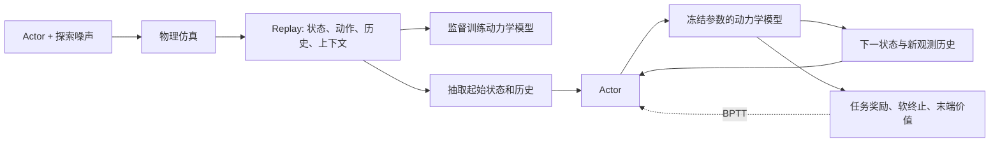

# SuperMimic 原理、HIMLoco 接口与源码索引

## SuperMimic 原理与训练流程：官方、Go2 和 HIMLoco

审计日期：2026-11-14。代码以 `manifests/upstreams.json` 的提交为准；论文参考 arXiv:2610.28480 v2。这里讲训练机制，WBLWBL 接入细节见 本文的 HIMLoco 接口审计和实验日志。方括号来源 ID 对应[可点击源码索引](architecture.md)及 `sources.json` 中的提交、文件和方法位置。

## 1. 它解决的是策略训练问题

普通 HIM-PPO 从物理仿真获取状态转移和奖励，用采样动作的概率比与优势更新策略。SuperMimic 另外学习动力学代理，在代理中展开短轨迹，将奖励对动作的导数传给策略。这条梯度不经过 PhysX 或 MuJoCo 的接触求解器，而经过神经网络。物理仿真仍负责提供可信的训练数据和评估。

用同一机器人完成不同动作时，目标不同但动力学有共享性。世界模型可以复用来自不同策略、指令的旧数据。这解释了大规模运动跟踪场景下的潜在收益；不能从人形运动库的 GPU-hours 比例推导 WBLWBL 的加速倍数。[P1 §3.1–3.3、§4]



## 2. 训练状态、策略观测和任务目标不能混用

记 `s` 为物理状态，`h` 为历史观测，`c` 为速度或参考运动目标，`xi` 为仿真上下文，`a` 为策略动作。对于 WBLWBL，Actor 仍应使用六帧本体观测；基座线速度和真实物理参数可以进入训练用世界模型或 Critic，但不直接进入部署 Actor。

模型的典型接口为 `next_state = dynamics(state, action, context)`。这不要求 state 等于 actor_obs。Go2 还显式输入上一动作和局部地形，并预测平面位姿增量；其 Actor 看历史传感信息而不是模型的全部输入。[G-WM `WorldModel.forward`; G-IM `_step`/`rollout`]

官方基础 Runner 默认 `actor_obs='rep_state'`、`history_length=1`，另支持 `proprio` 历史输入。论文的部署观测配置和当前基础类默认值不是同一件事。迁移时不能照抄默认值后宣称保持了 HIM 的信息约束。[O-RUN `BaseRunnerCfg`, `build_world_model`; P1 Appendix A]

## 3. 世界模型：从一步拟合到多步自回归

监督训练的目标可以概括为：

\[
\hat s_0=s_0,\qquad \hat s_{j+1}=f_\phi(\hat s_j,a_j,\xi)
\]
\[
L_{WM}=\mathbb E\sum_{j=1}^{K}m_j\|W(\hat s_j-s_j)\|^2.
\]

`a_j` 是日志中的动作，`m_j` 排除跨 reset 的无效预测，`W` 平衡不同量纲。模型每次使用自己上一时刻的预测，因而要学习在小误差条件下继续预测。论文 Eq.1 是包含状态、奖励、观测和终止头的通式；解析计算的头不需要对应监督损失。不能据此声称每份实现都训练了四个神经网络头。[P1 §3.2 Eq.1]

官方 `WorldModelLearner._rollout` 连续预测状态，由 representation 定义误差通道，以 nominal error 的平方倒数加权。Go2 使用残差 MLP、运行统计归一化，并在 `WorldModel.loss` 中计算状态和位姿误差；奖励与存活在 imagination 中计算。[O-WM `_rollout`, `_compute_losses`; G-WM `loss`]

注意长度计数：论文 K=8 指预测窗口；官方当前 `_rollout` 循环是 `actions.shape[1]-1`，其 buffer 时间张量包含状态边界。自己的 Replay API 必须明确为 **K 条动作、K+1 个状态**，不能只复制一个 `horizon=8` 就认定预测步数完全一致。

多步状态误差低是必要条件，但并不保证模型关于动作的 Jacobian 正确。四足接触切换附近尤其需要在物理仿真中验证策略优化方向。

## 4. 想象轨迹：每一步都要重新执行策略

模型训练与策略训练使用的动作不同：前者沿日志动作预测；后者沿当前策略产生的新动作预测。

\[
a_t=\pi_\theta(h_t,c_t),\quad
\hat s_{t+1}=f_\phi(\hat s_t,a_t,\xi),\quad
h_{t+1}=\operatorname{push}(h_t,g(\hat s_{t+1},a_t,c_{t+1},\eta_t)).
\]

`g` 合成策略实际需要的观测；`eta` 是外加传感器噪声。输入世界模型的是干净物理状态，Actor 可以继续接收带噪观测。想象中不能沿用真实日志的未来状态或未来传感帧，因为策略动作已经改变。

Go2 `Imagination.rollout` 不只是多次调用 MLP：它恢复起始观测历史，推进机器人位姿和目标生成器，计算观测与奖励，再让 Actor 采取下一动作。目标生成、地形查询、碰撞代理中有解析部分及停止梯度，不能把整个工程说成每一个算子都光滑可微。[G-IM `rollout`, `_step`, `_rewards`]

## 5. Actor、软存活与 Critic

取 H 步预测，定义 `d_t` 为从第 t 步走向下一步后的终止概率，`C_0=1`、`C_{t+1}=C_t(1-d_t)`：

\[
J(\theta)=\mathbb E\left[\sum_{t=0}^{H-1}\gamma^t C_t r_t+\gamma^H C_HV_\psi(x_H)\right].
\]

软存活使接近失败边界的状态也能给出梯度。它是硬终止判据的代理，必须在物理仿真保留真正的终止事件。官方跟踪高度／倾斜误差、Go2 跌倒倾角和 WBLWBL 底盘接触不是同一种判据。[O-ENV `_compute_term_prob`; G-IM; H-LOGIC `check_termination`]

H=32、控制周期 0.02 s 时，直接展开仅覆盖 0.64 s，Critic 估计之后的收益。没有 Critic 的纯 BPTT 可能忽视短轨迹之后的恢复或失衡。Critic 目标由想象轨迹反向递推：

\[
R_t=r_t+\gamma(1-d_t)[(1-\lambda)V(x_{t+1})+\lambda R_{t+1}],\quad R_H=V(x_H).
\]

固定这些目标，再回归 `V(x_t)`。出现 GAE 或 Actor-Critic 术语，不代表 Actor 使用 PPO；官方 `ActorCriticPolicyLearner` 是在 BPTT 基类上增加价值引导。[O-POL `_train_batch`, `_bootstrap`, `_fit_critic`; P1 Eq.2–3]

核心梯度中含有：

\[
\frac{\partial r_{t+1}}{\partial \hat s_{t+1}}
\frac{\partial f_\phi}{\partial a_t}
\frac{\partial\pi_\theta}{\partial\theta}.
\]

这给出“动作如何改变预测收益”的方向，代价是方向会受到模型偏差影响。

### 冻结权重不等于停止输入梯度

Actor 更新期间，世界模型和 Critic 的权重不应被 Actor 优化器修改，但必须允许损失对它们的输入求导。`requires_grad_(False)` 适用于冻结参数；`torch.no_grad()` 包住整个模型前向则会断开动作梯度。

官方显式冻结动力学／representation，计算末端价值时冻结 Critic，再在 Critic 拟合步骤解冻。Go2 `improve_policy` 显式冻结的是世界模型；Actor backward 可能产生 Critic 梯度，但只 step Actor 优化器，随后独立更新 Critic。新训练器计划显式管理三个优化器与冻结范围。[O-POL; G-TRAIN `improve_policy`]

## 6. 训练一次迭代到底发生什么

```text
用当前 Actor + 探索在物理仿真采样，记录执行动作和完整上下文
从 Replay 抽连续窗口，用记录动作多步拟合世界模型
从 Replay 抽起始状态和历史，固定模型权重
在模型里反复调用当前 Actor，生成 H 步闭环轨迹
用软存活加权奖励与末端价值更新 Actor
用这次轨迹的固定 TD(lambda) 目标更新 Critic
回到物理仿真采样，并定期独立评估
```

这是持续交替的学习过程，不是永久冻结一个离线模型后任策略自由优化。旧数据可继续用于模型拟合，但策略不断访问新状态，必须补充新数据。[P1 Algorithm A.1; O-RUN `run`; G-TRAIN `run`]

Go2 默认 WM window=8、H=32、4096 仿真环境、8192 想象起点、模型隐藏层 1024×3；官方基础模型隐藏层 2048×3、策略批次 4096。这些是不同实现的默认值，不是 16 GB 显存下的已验证 WBLWBL 配置。计划先缩小 batch 和时域，记录完整时间与内存后再扩大。

## 7. 官方与 Go2 对接 WBLWBL 的取舍

| 部分                | 借鉴内容                           | 需要重新实现／验证                              |
| ------------------- | ---------------------------------- | ----------------------------------------------- |
| 官方 learner        | BPTT、价值引导、归一化、优化器分离 | Python 3.11 兼容的独立实现，去掉 G1 motion 依赖 |
| 官方 representation | 状态与观测分离、几何计算           | WBLWBL 关节和四元数契约                         |
| Go2 world_model     | 残差模型、多步拟合、历史动作输入   | 机器人尺寸、上下文、执行器延迟                  |
| Go2 imagination     | 状态到新观测、任务奖励、历史更新   | HIM 45×6 帧格式、速度命令、原奖励语义          |
| Go2 data drivers    | 已有策略帮助覆盖有效运动           | 现有 WBLWBL checkpoint 是否有效需先评估         |
| Go2 target/terrain  | 追逐任务和地形闭环示例             | 不引入其追球输入、Go2 几何或预训练 Actor        |

官方代码主要面向 G1 参考运动跟踪，论文 v2 还描述速度接口；当前 Runner 的 motion/velocity slot 不应直接被当作 WBLWBL 速度环境。Go2 是无动作示范的任务奖励案例，支持将训练思想用于四足速度控制，但其发布说明明确仅做过仿真、训练路线存在分阶段和未完整复现的限制。[O-RUN; P1 Appendix B/G; G-README]

## 8. 建议阅读顺序

先读 Go2 `supermimic/train.py` 的 `improve_policy`，再读 `world_model.py` 的 `loss` 和 `imagine.py` 的 `rollout`。然后对照官方 `policy_learner.py`、`wm_learner.py`、`world_model_env.py`。最后读本仓库接口审计：它说明为什么上述流程不能原样接到当前 HIM Runner。

学习结束应能回答：记录动作和策略均值有什么不同？为什么要保留 reset 前状态？为什么冻结模型仍能训练 Actor？为什么 HIMEstimator.forward 需要另一条训练接口？为什么收益在模型里上升还不足以说明策略变好？

## WBLWBL Dog V1 × 本地 HIMLoco 源码审计

范围：`/home/qyw/MyHIMLoco` 工作树，2026-11-14。用户指定首个机器人为 **WBLWBL Dog V1**，选择正常行走 `wblwbl_dog_v1`；低趴任务为后续对照。本地 HEAD 和 20 份关键源码 SHA256 记录在 `../manifests/himloco_source.json`。工作树包含未提交修改和未跟踪 WBLWBL 配置／资产，单独记录 HEAD 不能复现本次审计。

## 已确认的实际接口

|项目|本地读取结果|证据|
|---|---|---|
|后端|已有 Isaac Lab 迁移版，直接导入本地修改的 rsl_rl|H-ENTRY, H-ADAPTER|
|物理／控制间隔|0.005 s × decimation 4 = 0.02 s，策略 50 Hz|H-BASE, H-CFG, H-ENV-CFG|
|动作|12 个关节；P 控制，scale=0.25，Kp=40、Kd=1；随机因子需另算|H-CFG, H-LOGIC `_compute_torques`|
|策略输入|45×6=270，最新帧在最前|H-BASE, H-LOGIC `compute_observations`|
|单帧布局|command 3，angular velocity 3，gravity 3，q-q0 12，qd 12，上一步执行动作 12|H-LOGIC|
|Critic 输入|238=45+3 线速度+3 外力+187 高度采样|H-BASE, H-LOGIC|
|HIM 输出|速度 3＋归一化 latent 16|H-EST|
|Actor 输入维数|45+3+16=64；隐藏层 512/256/128，ELU|H-ACTOR, H-CFG|
|PPO rollout|100 控制步/环境；不能与 Go2 的迭代数直接比较|H-CFG|
|行走高度|奖励目标 0.33 m；初始 root z=0.40 m|H-CFG|
|硬终止|指定底盘接触力范数 >1；另有时间截断|H-LOGIC `check_termination`|
|初始目标环境|stage=3 为平地；stage=4 才使用任务地形|H-CONFIG|

配置数字来自读取／解析，而不是本次仿真实测。关节顺序必须使用 `asset_contract()` 返回的列表（见 manifest），不能使用 default_joint_angles 字典的排列推断。HIMLabEnv 已通过 `joint_ids` 映射 Lab 关节与旧策略顺序。本次资产解析结果为 **RR → RL → FR → FL**，每条腿按 hip/thigh/calf 排列。正式运行仍要检查导入后的 `joint_ids`，不可照搬 Go2 或常见 FL/FR/RL/RR 顺序。来源 ID 的完整链接见[源码索引](architecture.md)。

## 需要特别处理的八处接口

### A. 梯度不是只在 Runner 外层被关闭

`HIMOnPolicyRunner.learn` 在 `torch.inference_mode()` 中采样；这对物理采样合理，但想象更新必须在其外。`HIMActorCritic.update_distribution` 在 no_grad 下调用估计器；`HIMEstimator.forward` 同时 detach 输入与输出，`encode` 也 detach 输入。

计划增加 `HIMDifferentiableActor` 包装器，在新仓库直接调用现有 `estimator.encoder`，切分并归一化输出，再调用原 `actor`。保持权重键兼容，冻结估计器权重但保留历史输入梯度；不在原仓库全面删掉 detach。只用 `act_inference` 仍会调用内部 detach，不能解决问题。[H-ACTOR, H-EST, H-RUN]

### B. 自动 reset 后的状态不是上一条转移的 next_state

Lab env 会在一次 step 内执行终止判断、奖励、reset 和新观测。当前 `_get_rewards` 仅保存 `terminal_ids` 和 `terminal_obs`；238 维 terminal critic observation 不等价于完整物理状态。

在新仓库继承 `HIMLabEnv`，在 reset 前的 hook 保存所有环境的 post-physics state、reward、terminated、truncated、上下文；再将 reset 后 policy observation 交给下一次采样。不得在普通 `env.step` 返回后才读取 root_state，当作死亡转移的 next_state。[H-ENV `_get_rewards`, `_reset_idx`; H-ADAPTER `step`]

### C. 现有 reset 没有显式清空整个历史

`LegacyLogic.reset_idx` 清空 last_actions 等缓存，但没有清空 `obs_buf`；新帧再被 prepend 到原历史。为公平基线，第一版保持现有行为并保存实际 270 维历史快照。物理模型的转移窗口仍必须按 episode_id 截断。不能凭历史窗口“应该如何”擅自改变基线。

若后续统一改成零填充／首帧填充，必须同时修改对照组，并作为独立实验记录；不能只改变 SuperMimic 一侧。[H-LOGIC `reset_idx`, `compute_observations`]

### D. 有两层动作时间尺度

`_pre_physics_step` 先 clamp 动作，再在四个物理子步之间随机切换上一动作和当前动作。delay 每控制步抽样，不能把它当作固定每 episode 的参数。模型必须知道这次实际执行的延迟，或对延迟显式边缘化；首个受控实验先对两组同时关闭 delay。

Replay 保存 noisy raw action、clipped action、上两次执行动作、delay_substep、控制参数。二阶 smoothness 需要 `a[t-2]`，只有 `a[t-1]` 不够。官方/Go2 的原动作语义不能代替这里的实际执行语义。[H-ENV `_pre_physics_step`; H-LOGIC `_compute_torques`, `_reward_smoothness`]

### E. 四元数约定已有转换

Lab 是 wxyz，legacy core 是 xyzw。`sync_state` 与 `write_root` 已转换。新模型在内部约定一个顺序并在边界转换；旋转预测用小旋转增量组合并归一化，不直接无限累加原始四元数。单位、参考系和关节顺序都写入 checkpoint schema。[H-ENV `sync_state`, `write_root`]

### F. heading command 不是永远固定的 yaw rate

当前配置 `heading_command=True`，第四维是目标 heading；每步根据当前姿态重新计算 `commands[:,2]` 并裁剪。若想象中一直保持起始三维指令，会与物理环境不同。

应保存四维命令、命令更新时间和 episode step，在预测姿态上重算 yaw 指令。第一版短时域禁止跨命令重采样边界，后续显式复制命令事件；也可将两组共同改为固定 yaw-rate 指令，但必须另命名受控实验。[H-LOGIC `_post_physics_step_callback`; H-CFG `commands`]

### G. 外力、随机 push 与物理参数

继承配置包含外力、根速度 push、摩擦、恢复系数、Kp/Kd 等随机化。有些随机量在 Python 配置中存在，却不一定真正乘入执行路径，例如本次读取的 P 控制公式没有乘 `motor_strength_factors`，不能仅凭开关就将它称为有效执行器随机化。

`_get_dones` 内 callback 会触发命令／push／外力事件；应区分 physics 后状态、事件后的下一决策状态和下一步待施加外力。对瞬间写入仿真器的 push，缓存 core 速度还可能需要同步。M1 同时关闭随机事件；后续捕获事件、时间和实际参数，不让确定性模型把未记录的跳变当成动力学误差。[H-ENV; H-CORE `_push_robots`, `_disturbance_robots`; H-LOGIC]

### H. 奖励不能只按名字复制

|现有非零奖励|可微重建要求|
|---|---|
|tracking_lin_vel / tracking_ang_vel|使用原 body-frame 定义、sigma=0.25 和更新后的命令|
|lin_vel_z / ang_vel_xy / orientation|从预测状态读取，保持观测缩放与物理奖励量分开|
|dof_acc|前后关节速度差除控制 dt，再平方|
|action_rate / smoothness|保留一阶／二阶动作历史，使用裁剪后动作|
|base_height|平地为地面相对高度；地形阶段复现采样函数|
|dof_pos / rear_thigh_pos|原关节权重与索引；不假定四条腿完全对称|
|foot_clearance|由 WBLWBL URDF FK/Jacobian 重建足位置和速度；原函数使用 body-frame 相对足高与平面足速，并非简单世界坐标抬脚高度|
|joint_power|原代码使用最后物理子步的 torque 缓存与当前 qd；以末状态再算 PD 会有时序差异|

奖励权重还会在 `_prepare_reward_function` 中乘控制 dt。首个算法实验可暂用明确的 `core_reward_v1`（暂不含 foot_clearance / joint_power），但 PPO 和 BPTT 两侧必须同时使用相同目标，并单独报告与原任务差异。恢复完整奖励时，FK 必须在真实状态上数值对齐；最后子步 torque 可增加辅助预测头，不能声称用末状态 PD 就严格等价。[H-CFG, H-LOGIC]

## 环境与资产状态

原工程 README 记录 RTX 5060 Ti 16 GB、Python 3.11.17、PyTorch 2.7.0+cu128、Isaac Sim 5.1、Isaac Lab 2.3.2。本次仅解析配置和资产契约，没有重跑这些运行验证；当前工具会话的 nvidia-smi 无法连接驱动，可能与会话访问条件有关，不能据此诊断宿主机驱动损坏。训练前应在实际运行终端复核 GPU、解释器和空闲显存。

官方 SuperMimic `pyproject.toml` 要求 Python >=3.13,<3.14，`uv.sources` 使用相邻 mjlab_research 路径。当前只拉取用户指定的两个子模块，不自动安装这个额外仿真栈。独立实现 `him_supermimic` 使现有 Lab 环境与源码参考可共存。

## 来源与固定代码位置

所有上游链接固定到本次子模块提交。本机链接对应审计时的工作树；完整哈希见 manifest。

- **O-POL** — [Official policy learners](https://github.com/HybridRobotics/supermimic/blob/abc124c1bd5976341034668af3d12c087f2f1f55/src/supermimic/learners/policy_learner.py)。位置：BpttPolicyLearner.update/_train_batch; ActorCriticPolicyLearner._bootstrap/_fit_critic; gae_returns。
- **O-WM** — [Official supervised world-model learner](https://github.com/HybridRobotics/supermimic/blob/abc124c1bd5976341034668af3d12c087f2f1f55/src/supermimic/learners/wm_learner.py)。位置：WorldModelLearnerCfg; _rollout; _compute_losses; update_normalization。
- **O-RUN** — [Official runner](https://github.com/HybridRobotics/supermimic/blob/abc124c1bd5976341034668af3d12c087f2f1f55/src/supermimic/runners/supermimic_runner.py)。位置：BaseRunnerCfg; build_world_model; _step_and_store; SuperMimicRunner.run。
- **O-ENV** — [Official differentiable world-model environment](https://github.com/HybridRobotics/supermimic/blob/abc124c1bd5976341034668af3d12c087f2f1f55/src/supermimic/envs/world_model_env.py)。位置：_wm_step; _compute_term_prob; _synth_sensor; sample_initial_states。
- **O-PROJECT** — [Official dependency specification](https://github.com/HybridRobotics/supermimic/blob/abc124c1bd5976341034668af3d12c087f2f1f55/pyproject.toml)。位置：project.requires-python; tool.uv.sources。
- **G-WM** — [Go2 residual world model](https://github.com/Zhengtianjin/go2-supermimic/blob/d9eee9b3f248e5300e636c433255db2c1c3e086a/go2_supermimic/supermimic/world_model.py)。位置：WorldModel.forward; WorldModel.loss; RunningNorm。
- **G-IM** — [Go2 imagination](https://github.com/Zhengtianjin/go2-supermimic/blob/d9eee9b3f248e5300e636c433255db2c1c3e086a/go2_supermimic/supermimic/imagine.py)。位置：Imagination._step; _rewards; fall_prob; rollout; gae_targets。
- **G-TRAIN** — [Go2 alternating trainer](https://github.com/Zhengtianjin/go2-supermimic/blob/d9eee9b3f248e5300e636c433255db2c1c3e086a/go2_supermimic/supermimic/train.py)。位置：TrainCfg; improve_policy; run。
- **G-README** — [Go2 task and reproduction limitations](https://github.com/Zhengtianjin/go2-supermimic/blob/d9eee9b3f248e5300e636c433255db2c1c3e086a/README.md)。位置：Interfaces; How the released policies were trained; Limitations。
- **H-MIGRATION** — [Local runtime documentation](/home/qyw/MyHIMLoco/isaaclab_migration/README.md)。位置：当前运行环境; 可视化训练与导出。
- **H-ENTRY** — [Local training entry](/home/qyw/MyHIMLoco/isaaclab_migration/scripts/train.py)。位置：AppLauncher; stage/task parsing; Runner selection。
- **H-CONFIG** — [Local configuration loading](/home/qyw/MyHIMLoco/isaaclab_migration/himloco_lab/config.py)。位置：load_config; asset_contract。
- **H-CFG** — [WBLWBL walking configuration](/home/qyw/MyHIMLoco/isaaclab_migration/himloco_lab/legacy/wblwbl_dog_v1/wblwbl_dog_v1_config.py)。位置：WblwblDogV1Cfg; WblwblDogV1CfgPPO。
- **H-BASE** — [Inherited configuration](/home/qyw/MyHIMLoco/isaaclab_migration/himloco_lab/legacy/base/legged_robot_config.py)。位置：env; domain_rand; sim; normalization。
- **H-ENV-CFG** — [Isaac Lab environment configuration](/home/qyw/MyHIMLoco/isaaclab_migration/himloco_lab/env_cfg.py)。位置：HIMEnvCfg; make_env_cfg。
- **H-ENV** — [Lab lifecycle and actuation](/home/qyw/MyHIMLoco/isaaclab_migration/himloco_lab/env.py)。位置：sync_state; _pre_physics_step; _apply_action; _get_dones; _get_rewards; _reset_idx; _get_observations。
- **H-CORE** — [Core state and external events](/home/qyw/MyHIMLoco/isaaclab_migration/himloco_lab/core.py)。位置：HIMCore.__init__; _push_robots; _disturbance_robots。
- **H-LOGIC** — [Legacy observations and rewards](/home/qyw/MyHIMLoco/isaaclab_migration/himloco_lab/logic.py)。位置：check_termination; reset_idx; compute_observations; compute_termination_observations; _post_physics_step_callback; _compute_torques; reward functions。
- **H-ADAPTER** — [Legacy Runner adapter](/home/qyw/MyHIMLoco/isaaclab_migration/himloco_lab/adapter.py)。位置：LegacyRunnerAdapter.step/reset。
- **H-ACTOR** — [Local HIM actor](/home/qyw/MyHIMLoco/rsl_rl/rsl_rl/modules/him_actor_critic.py)。位置：HIMActorCritic.__init__; update_distribution; act_inference。
- **H-EST** — [Local HIM estimator](/home/qyw/MyHIMLoco/rsl_rl/rsl_rl/modules/him_estimator.py)。位置：HIMEstimator.forward/encode; HIMEstimator.update。
- **H-PPO** — [Local HIM PPO update](/home/qyw/MyHIMLoco/rsl_rl/rsl_rl/algorithms/him_ppo.py)。位置：act; process_env_step; update。
- **H-RUN** — [Local HIM runner](/home/qyw/MyHIMLoco/rsl_rl/rsl_rl/runners/him_on_policy_runner.py)。位置：HIMOnPolicyRunner.learn。
- **P1** — [SuperMimic: Scaling Humanoid Whole-Body Control with One Differentiable World Model](https://arxiv.org/abs/2610.28480v2)。位置：Section 3.1–3.3, Equations 1–3; Appendix A–D, Algorithm A.1, Tables A.4–A.6; Limitations。
